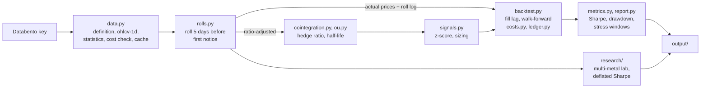

# finm37000-project

[](https://github.com/ryotahidaka/finm37000-project/actions/workflows/tests.yml)

A research framework for futures relative-value strategies on real CME data, and an evaluation of metals spread trades built with it. Gold vs silver (GC/SI) is the first case study: a cost-aware, out-of-sample pairs backtest that turns out not to make money. The research lab in `research/` then widens the search to platinum, palladium and copper, curve trades and cross-sectional strategies, and corrects every result for the number of things we tried.

## Team

| Member | GitHub | Part 1 role |
| --- | --- | --- |
| Ryota Hidaka | ryotahidaka | Tech leader (owns this repo) |
| Abinaya Ankur Raut | kira7688 | Communication leader (README) |
| Konark Gupta | konark20 | Design leader (Issues) |
| Raymond Wang | raymondw112 | Design leader (Issues) |

Team communication channel: WhatsApp

## What it does

1. Pulls daily bars, contract definitions and settlement prices for every contract from Databento (`GLBX.MDP3`), with a cost check before any request and a local cache so nothing is billed twice.
2. Builds continuous series that roll 5 business days before first notice: a ratio-adjusted series for signals and the actual contract prices for PnL, with every roll logged and charged.
3. Tests the relationship: Engle-Granger and Johansen cointegration, rolling and Kalman hedge ratios, OU half-life, year by year as well as on the full sample.
4. Backtests in real contracts. Beta-neutral sizing with standard contracts plus micros (MGC, SIL), fills one day after the signal, half a tick plus exchange fee plus commission per leg, walk-forward parameter selection.
5. Explains the PnL. A ledger splits it into the ideal spread, whole-contract rounding, trade costs and roll costs.
6. Writes a report with Sharpe, drawdown, trade stats, the four stress windows (2011, 2013, 2020, 2022), sensitivities and figures.
7. Research lab: runs 182 more configurations across five metals and scores them with the deflated Sharpe ratio.

## Scope

- Markets: COMEX gold (GC) and silver (SI) with micros (MGC, SIL); NYMEX platinum (PL) and palladium (PA); COMEX copper (HG) in the lab.
- Frequency: daily signals on daily closes or settlements.
- Dates: 2010-06-06 (start of `GLBX.MDP3`) to October 2026. Lab results are scored on 2014 to 2026.
- Data: Databento `GLBX.MDP3`, schemas `definition`, `ohlcv-1d` and `statistics` (settlement and open interest), via parent symbology (`GC.FUT` and so on).
- Out of scope: intraday execution and order-book work (Part B), other exchanges. See [Future scope](#future-scope).

## Data

Data comes from [Databento](https://databento.com/) under the course's CME license. A Databento API key is required: set it as an environment variable or in `.env`, never commit it. Raw downloads are cached under `data/` (git-ignored). Without a key, `--source synthetic` runs the whole pipeline on synthetic data with a known answer.

## Getting started

Requirements: Python 3.12, git, a Databento API key.

```bash
git clone https://github.com/ryotahidaka/finm37000-project.git
cd finm37000-project

python3.12 -m venv .venv
source .venv/bin/activate
pip install -r requirements.txt   # pinned versions; also installs src/gcsi in editable mode

cp .env.example .env              # then paste your key into .env (git-ignored)
pytest                            # import smoke test; should pass on a fresh clone
```

The key is read from the `DATABENTO_API_KEY` environment variable: export it as above, or put it in `.env`. If neither is set, `gcsi.data` falls back to the course helper `finm37000.get_databento_api_key()`, which reads `~/.databento_api_key`.

`requirements.txt` pins every package, including the course `finm37000` package at a fixed commit. Direct dependencies are declared in `pyproject.toml`. Use `pip install -e ".[dev]"` instead if you only want the latest compatible versions.

## How to run

Windows cmd (PowerShell: use `$env:PYTHONPATH="src"` instead of `set`):

```
set PYTHONPATH=src

:: 1. data: free estimate first, then pull and cache GC and SI
python -m gcsi.data --cost-only
python -m gcsi.data --start 2010-06-06 --end 2026-10-25

:: 2. the GC/SI study: continuous series, cointegration, OU, baseline and walk-forward
::    backtests, sensitivities, stress windows, figures -> output\databento\report.md
python -m gcsi.report --source databento --start 2010-06-06 --cache-only

:: 3. the research lab on every metal in the cache -> output\lab\
python research\run_all.py --cache data\databento --out output\lab
python research\build_report.py --out output\lab

:: no key? the same pipeline on synthetic data (true beta 0.8, half-life 13.9 days)
python -m gcsi.report --source synthetic
```

On macOS or Linux use `export PYTHONPATH=src` and forward slashes. The lab needs PL, PA and HG bars and settlement files in the cache; see [research/README.md](research/README.md).

## Architecture



Signals use the ratio-adjusted series so roll gaps never look like price moves; PnL uses the price of the contract actually held that day. Details and design decisions are in [docs/DESIGN.md](docs/DESIGN.md).

## Results

### GC/SI case study

Databento `GLBX.MDP3`, 7 Jun 2010 to 23 Oct 2026, 4,248 days with both legs, 81 gold and 82 silver rolls. Full report: [docs/results/report.md](docs/results/report.md).

| Out of sample, after costs | Walk-forward 2015-2026 | Baseline 2011-2026 (fixed parameters) |
| --- | --- | --- |
| Sharpe | -0.85 | -0.21 |
| Annual return on $1m gold notional | -6.8% | -1.7% |
| Max drawdown | -86% | -48% |
| Round trips (per year) | 43 (3.5) | 72 (4.5) |
| Win rate | 37% | 58% |

- Not cointegrated over 2010-2026: Engle-Granger p-value 0.87, Johansen rank 0. Single years pass at 5% only twice (2014, 2015).
- Mean reversion lives on short windows only: a half-life of 12-14 days on the last 6-12 months, 940 days on the full sample.
- The ratio trends. It went from 32 (Apr 2011) to 122 (Mar 2020) and back to 46 (Jan 2026). The big losses come when the spread trends through the stop.
- Costs are not the problem: about $31k of trading and roll costs over 16 years against a gross loss of $236k.
- No variant rescues it. A Kalman hedge, a regime filter, shorter horizons and dollar-neutral sizing all land between -0.45 and 0.15. The regime filter cuts the drawdown from 48% to 12% but earns about nothing.
- The same code earns a walk-forward Sharpe of 1.15 on synthetic data with real mean reversion, and loses money on a control without it, so the negative result is about the market, not the plumbing.

### Research lab: five metals, 191 configurations

Settlement prices for GC, SI, PL, PA and HG, scored 2014-2026 on $1m. Summary: [docs/results/lab/summary.md](docs/results/lab/summary.md).

| Configuration | Sharpe | Return a year | Max drawdown |
| --- | --- | --- | --- |
| PCA residual s-score, 30d OU window | 0.54 | 5.3% | -23% |
| GC calendar spread, spread-book costs | 0.53 | 0.25% | -0.9% |
| GC calendar spread, walk-forward | 0.31 | 0.15% | -1.6% |
| Cross-sectional momentum, 2 per side | 0.29 | 2.5% | -24% |
| Johansen 3-metal basket | 0.23 | 1.1% | -9% |
| Pairs selected by cointegration each year (best of 4) | 0.05 | 0.3% | -14% |

- Nothing passes the deflated Sharpe test across all 191 tries. The luck benchmark (expected best Sharpe under the null) is 2.02, set mostly by the wide spread of the 144 curve-grid runs.
- The PCA residual is the most promising lead. With only 2 tries it has a 97% probability of a positive true Sharpe on its own, but its gain is recent: Sharpe -0.44 in 2014-2017, 0.35 in 2018-2021, 1.12 in 2022-2026.
- The GC calendar is steady but tiny in dollars, and it is the best of 144 grid points, so it fails the correction.
- Picking pairs by cointegration each year does no better than GC/SI. Strategies that do not assume mean reversion (residual, momentum, carry) are the ones with a positive sign.

## What we learned

- A spread is only as mean-reverting as the economic force that ties it together. Gold and silver share drivers but nothing forces their ratio back, so it trends for years.
- Futures plumbing decides whether a backtest is believable: per-contract data, rolls before first notice, ratio-adjusted signals vs actual-price PnL, settlement prices instead of last trades, whole contracts and micros, and a cost on every leg.
- With enough tries something always looks good. Counting every configuration and deflating the Sharpe is what separates a lead from luck.

## Limitations

- Daily data only, with a one-day fill lag; no intraday execution or queue modelling.
- Costs are a half-tick model with fixed fees; the spread-book mode assumes the listed spread trades at the same half tick.
- The lab universe is only five metals, so cross-sectional strategies have very few names.
- The deflated Sharpe uses all trials as one family; within-family numbers are shown alongside.
- Platinum, palladium and copper fees are assumed (exchange fee $1.60 plus commission $0.85).

## Running the tests

```bash
pytest            # skips tests marked `db` (they need Databento access)
pytest -m db      # run only the Databento tests
```

GitHub Actions ([.github/workflows/tests.yml](.github/workflows/tests.yml)) runs `pytest -q` on Python 3.12, on Linux and Windows, for every pull request to `main` and every push to `main`. It uses no secrets, so `db` tests are always skipped there.

`tests/test_research.py` covers the lab's statistical helpers on synthetic series.

## Repository layout

```
finm37000-project/
├── README.md
├── pyproject.toml, requirements.txt, .env.example
├── docs/DESIGN.md              pipeline, components, design decisions
├── docs/results/               GC/SI report, tables, figures
├── docs/results/lab/           lab trial tables and summary
├── src/gcsi/                   contracts, data, rolls, cointegration, ou, signals,
│                               costs, ledger, backtest, metrics, report, synthetic
├── research/                   multi-metal strategy lab (see research/README.md)
├── notebooks/                  exploration and presentation only
├── tests/
├── data/                       Databento cache (git-ignored)
└── output/                     generated tables and figures (git-ignored)
```

## Roadmap

| Milestone | Course due | Goal |
| --- | --- | --- |
| Part 1 | Lecture 2 | Repo, README, and Issues agreed by all members |
| Part 2 | Lecture 3 | Environment, test fixtures, contract specs, continuous series (#3, #14, #18, #5) |
| Part 3 | Lecture 4 | Ingestion, CI, cointegration and OU, signals, backtest skeleton (#4, #23, #7, #8, #9, #10) |
| Part 4 | Lecture 5 | Cost model, PnL ledger, full backtest, EDA, evaluation (#24, #25, #10, #6, #11) |
| Completion | Final | Real-data results, research lab, final write-up and presentation (#13) |

## Contributing / workflow

1. Fork the main repo (owned by the Tech leader) and clone your fork.
2. Create a branch per issue (`git checkout -b issue-<n>-short-name`).
3. Open a pull request to the main repo that references the issue (`Closes #<n>`).
4. At least one other team member reviews; the Tech leader merges.

## Future scope

The framework is not tied to metals. The natural next study asks where spread mean reversion actually lives, ranking spreads by how hard the economic link between the legs is:

| Class | Examples | Why the legs are tied | What we expect |
| --- | --- | --- | --- |
| Same product, different venue | CL vs ICE WTI, NYMEX Brent (BZ) vs ICE Brent, NG vs HH | Same underlying and settlement reference | Near-certain convergence, but a few ticks wide: an execution problem |
| Processing margins | 3-2-1 and 1-1 crack spreads, Brent vs gasoil, soybean crush, raw vs white sugar, corn and sugar vs ethanol | Refinery, crusher and mill margins pull back when plants change runs | Real mean reversion with strong seasonality |
| Substitutes and location | WTI vs Brent, NG vs TTF, NY vs London cocoa with a GBP leg, arabica vs robusta, Chicago vs KC wheat | Shipping and substitution, which can break for years | Mean reversion with regime breaks; GC/SI belongs here |
| Calendars | Crude and gas calendars, winter vs summer gas | Storage economics | The curve code in `research/` carries over |

What it needs:

- ICE Futures US, ICE Futures Europe and ICE Endex data (available on Databento from Dec 2018) next to CME, with FX legs for non-USD contracts.
- Unit conversions and fixed ratios (barrels vs gallons, bushels vs short tons) on top of the existing beta and micro sizing.
- Holiday and settlement-time alignment across exchanges.
- Intraday data and a fill model for the venue-arbitrage class, which is Part B of the course: legging the spread on the harder side, routing between standard and micro books, and an execution simulator on top-of-book data (formerly #26, #27).
- A copula signal as a second bivariate model (formerly #12).

Note that the course does not permit a Brent/WTI mean-reversion strategy, so energy work would be framed as a research extension rather than this project's deliverable.

## References

- [Databento documentation](https://databento.com/docs)
- Engle, R. and Granger, C. (1987), Co-integration and error correction, *Econometrica* 55(2)
- Gatev, E., Goetzmann, W. and Rouwenhorst, K. G. (2006), Pairs trading: performance of a relative-value arbitrage rule, *Review of Financial Studies* 19(3)
- Vidyamurthy, G. (2004), *Pairs Trading: Quantitative Methods and Analysis*, Wiley
- [CME Group gold and silver contract specifications](https://www.cmegroup.com/markets/metals/precious/gold.contractSpecs.html)
- [COMEX fee pass-through schedule (Interactive Brokers)](https://brokerage.ibkr.com/en/accounts/fees/COMEX.php)
- Avellaneda, M. and Lee, J.-H. (2010), Statistical arbitrage in the US equities market, *Quantitative Finance* 10(7)
- Bailey, D. and Lopez de Prado, M. (2014), The deflated Sharpe ratio, *Journal of Portfolio Management* 40(5)
- Koijen, R., Moskowitz, T., Pedersen, L. and Vrugt, E. (2018), Carry, *Journal of Financial Economics* 127(2)
