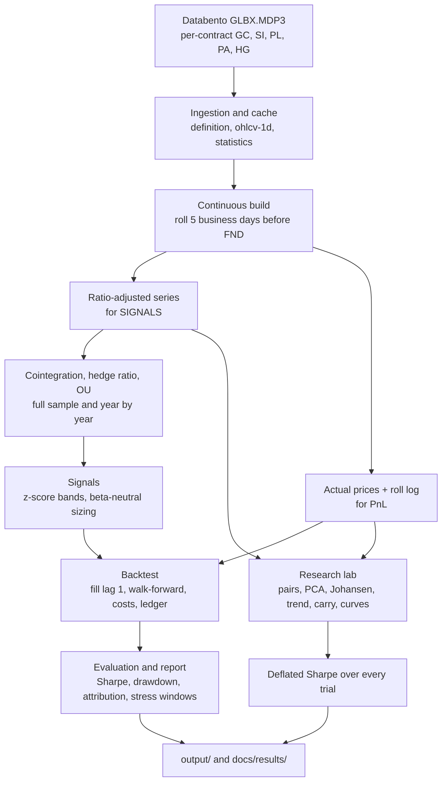
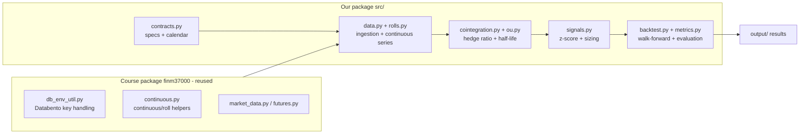

# Project design

How the pieces fit together and why. The README says what the project delivers and how to run it; this document covers the pipeline, the components, the design decisions and where the work goes next.

## 1. Goal in one line

A reproducible research framework that pulls CME futures from Databento, builds roll-aware continuous series, and tests relative-value strategies with realistic contract sizing and costs, then reports honestly whether an edge survives. Gold vs silver is the first case study; the research lab extends it to five metals.

## 2. Scope

After the professor's review on 18 Oct the project has one focus: daily strategies with long-run continuous adjustment and an honest, cost-aware backtest. Trade-level execution (legging, routing, replaying intraday quotes) is Part B material and sits in [future work](#8-future-work).

- Signals once a day, on the ratio-adjusted continuous series.
- Positions in real contracts (GC/SI with MGC/SIL for the remainder), marked on actual prices, every roll charged.
- Data: `GLBX.MDP3` from 2010-06-06, `definition`, `ohlcv-1d` and `statistics` per contract via parent symbology.

## 3. Pipeline (data to result)

## 4. Components

We reuse the professor's `finm37000` package for the data and roll plumbing rather than rebuilding it; our package holds the pairs-trading logic on top.

The `research/` folder sits beside `src/gcsi`: it imports the contract specs, rolls, cost model and ledger, adds platinum, palladium and copper specs, and runs the wider strategy search. It is exploration code with light tests; `src/gcsi` is the tested core.

## 5. Key design decisions

| Decision | Choice | Why |
|---|---|---|
| Case study | Gold (GC) vs silver (SI) | Economically linked, liquid, with micros for fine sizing; course-permitted |
| Continuous series | Two series: ratio-adjusted for signals, actual prices for PnL | Mixing them corrupts either the signal (roll gaps look like moves) or the PnL |
| Roll | 5 business days before first notice | Avoids delivery and the thin last days; logged and charged as two trades |
| Hedge ratio | Trailing 1-year OLS, Kalman as a sensitivity | The relationship drifts; a static full-sample beta would look ahead |
| Signal | z-score with the lookback re-priced at today's beta | A consistent z-score; otherwise beta changes create fake signals |
| Fills | One day after the signal at the close | No same-close fills on a signal computed from that close |
| Costs | Half a tick + exchange fee + commission per contract per side | A spread crosses both legs on entry, exit and every roll |
| Attribution | Ledger splits ideal spread, sizing rounding, trade and roll costs | Shows whether losses come from the idea or from frictions |
| Parameter choice | Walk-forward on the previous 3 years | Out-of-sample by construction |
| Prices in the lab | Official settlements (`statistics`, stat 3) | Both legs priced at the same moment; last trades print at different times |
| Multiple testing | Count every configuration, report the deflated Sharpe | With 191 tries the best Sharpe is not evidence on its own |
| Leverage in the lab | Leg notional capped at $2m; spread-book cost mode for curve trades | Quiet spreads would otherwise be levered without limit; a listed spread is one fill |
| Libraries | statsmodels, scipy, pykalman | Free, standard, no paid tooling |

## 6. How the Issues map to components

| Issue | Component | Produces |
|---|---|---|
| #3 Structure + env | repo root | installable environment |
| #18 Contract specs | `contracts.py` | multipliers, ticks, FND / last-trade calendar |
| #4 Databento ingestion | `data.py` | cached GC/SI frames |
| #5 Continuous + roll | `rolls.py` | ratio-adjusted + real-price series |
| #6 EDA | `report.py` (`eda`) | cointegration by year, half-life by window, tradability assessment |
| #7 Cointegration + hedge ratio | `cointegration.py` | spread definition |
| #8 OU + half-life | `ou.py` | reversion parameters |
| #9 Signal generation | `signals.py` | dated positions |
| #10 Backtest | `backtest.py` | equity curve with costs |
| #24 Cost model | `costs.py` | cost per fill and per roll |
| #25 PnL ledger | `ledger.py` | fills, daily PnL split into ideal spread / whole-contract sizing / trade costs / roll costs |
| #23 CI | `.github/workflows` | tests on every PR |
| #11 Evaluation | `metrics.py` + `report.py` -> `output/` | metrics, stress windows, report.md + figures |

| (lab) Research lab | `research/` | 182 more configurations on five metals, trial tables, deflated Sharpe |

## 7. Central risk, and how it played out

We stated up front that the gold/silver relationship might not be stable and that a clear negative result, honestly shown, would be a valid outcome. That is what happened: the pair is not cointegrated over 2010-2026 (Engle-Granger p 0.87), the ratio trends for years, and the walk-forward Sharpe is -0.85 after costs, with costs only about $31k against a $236k gross loss. The synthetic check (Sharpe 1.15 when mean reversion is built in) shows the code is not the reason. The research lab then showed that strategies that do not assume mean reversion between two metals (PCA residuals, momentum, carry) are the ones with a positive sign, though none clears the multiple-testing bar.

## 8. Future work

| Idea | Why it's interesting | What it needs | Was |
|---|---|---|---|
| Cross-commodity spread taxonomy | Test whether mean reversion strength ranks with how hard the link between legs is: venue arbitrage (CL vs ICE WTI, BZ vs ICE Brent, NG vs HH), processing margins (cracks, soybean crush, white sugar premium, ethanol), substitutes (WTI vs Brent, NG vs TTF, NY vs London cocoa, arabica vs robusta, wheat spreads), calendars | ICE Futures US, ICE Futures Europe and ICE Endex data next to CME, FX legs, unit conversions, cross-exchange calendars. Energy mean reversion is outside this course's permitted strategies, so this is a research extension | (new) |
| Execution layer | Leg the spread on the harder-to-fill side, route between standard and micro books | Intraday data, its own validation | #26 |
| Execution simulator | Replay top-of-book to measure what the execution layer saves | MBP-1 or BBO history and a fill model | #27 |
| Copula signal | A second bivariate model to compare with cointegration and OU | Gains usually marginal after costs | #12 |
| Regime-aware PCA residual | The lab's best lead earns most of its Sharpe after 2022; test whether a regime filter or volatility scaling makes it stable | More history or more names (the ICE metals and other CME commodities) | (new) |
