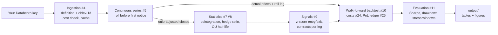

# Planning notes (development README)

> This was the project README while we built the pipeline (Parts 1-4): scope, team roles, roadmap and workflow. It is kept for reference. The [README](../README.md) is the final report.

[](https://github.com/ryotahidaka/finm37000-project/actions/workflows/tests.yml)

> **Status: complete.** One command pulls the data, runs the analysis and both backtests, and writes the report (see [Running the project](#running-the-project) and [Results](#results)). Scope is the daily strategy, after the professor's review on 18 Oct; see [Future work](#future-work).

## Team

| Member | GitHub | Part 1 role |
| --- | --- | --- |
| Ryota Hidaka | ryotahidaka | Tech leader (owns this repo) |
| Abinaya Ankur Raut | kira7688 | Communication leader (README) |
| Konark Gupta | konark20 | Design leader (Issues) |
| Raymond Wang | raymondw112 | Design leader (Issues) |

Team communication channel: **WhatsApp**

## Project Summary

#### Q) State the question or application, the CME market(s), and the expected output.

A) Can a daily mean-reversion trade on the gold-silver spread make money after costs? We trade the spread log GC − α − β·log SI on COMEX gold (GC) and silver (SI) futures, sized beta-neutral with micros (MGC, SIL), using Databento daily bars for every contract since 2010. The output is an out-of-sample, cost-aware backtest with a report: Sharpe, drawdown, PnL attribution and the four stress windows.

### Motivation

#### Q) Why is this interesting? What market-structure feature or trading idea does it explore?

A) Gold and silver respond to the same drivers (real rates, the dollar, risk appetite), but silver also has an industrial leg, so the two drift apart and come back. Doing this properly on futures exercises the market-structure side of the course: per-contract data, roll schedules before first notice, ratio-adjusted series for signals vs actual prices for PnL, contract multipliers and micros for sizing, and tick-based costs.

### Scope

- **Market(s):** COMEX precious-metals futures: Gold (GC) and Silver (SI), with Micro Gold (MGC) and Micro Silver (SIL) for sizing
- **Frequency:** daily signals on daily closes
- **Date range:** 2010-06-06 (start of `GLBX.MDP3`) to today; stress windows Aug-Dec 2011, Apr 2013, Mar 2020, 2022 (#19)
- **Databento dataset and schema:** `GLBX.MDP3` (CME Globex). Schemas: `definition` and `ohlcv-1d` for every GC and SI contract via parent symbology (`GC.FUT`, `SI.FUT`); optionally `statistics` for settlement and open interest
- **Out of scope:** intraday execution analysis, execution simulation and a copula signal (see [Future work](#future-work)). A Brent/WTI mean-reverting strategy is not permitted for this course.

### How it works



Signals use the ratio-adjusted series so roll gaps never look like price moves; PnL uses actual prices of the contract held that day, with each roll charged explicitly.

### Desired Outcome

By the end of the project, a user can run a single documented workflow that:

1. downloads (or loads cached) Databento CME data,
2. cleans and transforms it,
3. runs the analysis, simulation, or strategy, and
4. writes results (tables, figures, a summary) to an output folder.

#### Q) Describe the final deliverable and the headline results we expect to show.

A) `python -m gcsi.report` produces `output/databento/report.md` with: the cointegration evidence (full sample and year by year), the OU half-life, a baseline backtest with pre-committed parameters, a walk-forward out-of-sample backtest after costs, PnL attribution (spread, whole-contract sizing, trade costs, roll costs), sensitivities, and the stress windows. Headline numbers are in [Results](#results).


## Course Logistics

### Data

Data comes from [Databento](https://databento.com/) under the course's CME license.

- A Databento API key is required. Set it as an environment variable; never commit it.
  ```bash
  export DATABENTO_API_KEY="your-key-here"
  ```
- Raw downloads are cached under `data/` (git-ignored) so the same request isn't billed or downloaded twice.
- **Additional data sources:** none. Without a key, `python -m gcsi.report --source synthetic` runs the whole pipeline on synthetic data with a known answer.

### Getting Started

**Requirements:** Python 3.12, git, a Databento API key.

```bash
git clone https://github.com/ryotahidaka/finm37000-project.git
cd finm37000-project

python3.12 -m venv .venv
source .venv/bin/activate
pip install -r requirements.txt   # pinned versions; also installs src/gcsi in editable mode

cp .env.example .env              # then paste your key into .env (git-ignored)
pytest                            # import smoke test; should pass on a fresh clone
```

The key is read from the `DATABENTO_API_KEY` environment variable: export it as above, or put it in `.env`. If neither is set, `gcsi.data` falls back to the course helper `finm37000.get_databento_api_key()`, which reads `~/.databento_api_key`.

`requirements.txt` pins every package, including the course `finm37000` package at a fixed commit. Direct dependencies are declared in `pyproject.toml`. Use `pip install -e ".[dev]"` instead if you only want the latest compatible versions.

### Running the project

```bash
# 1. Fetch and cache data (GC and SI daily bars, every contract, from the dataset start)
python -m gcsi.data --cost-only                          # free: prints the estimated cost
python -m gcsi.data --start 2010-06-06 --end YYYY-MM-DD  # pulls, validates, caches under data/databento/
#    Refuses to pull if the estimate is above --max-cost (default $5) unless you add --yes.
#    A second run is served from the cache and makes no requests.

# 2. Run everything: continuous series, cointegration and OU, baseline + walk-forward
#    backtests, sensitivities, stress windows, figures (uses the cache from step 1)
python -m gcsi.report --source databento --start 2010-06-06
#    (add --cache-only to never call Databento and read only data/databento/)

# 3. Read output/databento/report.md (tables + fig_*.png next to it)

# No key? The same pipeline on synthetic data with a known answer (beta 0.8, half-life 13.9 days):
python -m gcsi.report --source synthetic
```

### Results

<!-- RESULTS -->
Real data: Databento GLBX.MDP3, 7 Jun 2010 to 23 Oct 2026, 4,248 days with both legs, 81 gold and 82 silver rolls. Full report: [docs/results/report.md](results/report.md), regenerated by `python -m gcsi.report`.

The strategy does not make money, and the reason is the pair, not the costs.

| Out of sample, after costs | Walk-forward 2015-2026 | Baseline 2011-2026 (fixed parameters) |
| --- | --- | --- |
| Sharpe | -0.85 | -0.21 |
| Annual return on $1m gold notional | -6.8% | -1.7% |
| Max drawdown | -86% | -48% |
| Round trips (per year) | 43 (3.5) | 72 (4.5) |
| Win rate | 37% | 58% |

- **Not cointegrated over 2010-2026.** Engle-Granger p-value 0.87, Johansen rank 0. Single years pass the 5% test only twice (2014, 2015).
- **Mean reversion lives on short windows only.** The half-life of the spread is 12-14 trading days fitted on the last 6-12 months, but 940 days on the full sample.
- **Long trends do the damage.** The gold/silver ratio went from 32 (Apr 2011) to 122 (Mar 2020) and down to 46 (Jan 2026). The big losses are 2020 and 2025, when the spread trended through the stop.
- **Costs are small.** About $31k of trading and roll costs over 16 years, against a gross loss of $236k before costs.
- **No variant rescues it.** Same-close fills, a Kalman hedge ratio and no micros all stay negative. Dollar-neutral sizing is slightly positive (Sharpe 0.15), which is not evidence of an edge.

Pipeline check on synthetic data (`--source synthetic`, 16 years, true β 0.8, half-life 13.9 days): the same code earns a walk-forward Sharpe of 1.15 after costs, and a control with no mean reversion loses money. So the negative real result is about the market, not the plumbing.
<!-- /RESULTS -->

How the backtest works (details in `src/gcsi/backtest.py`):

- Hedge ratio from a trailing 1-year OLS of log GC on log SI, shifted one day (Kalman filter as a sensitivity run).
- z-score of the spread with the past 60 days re-priced at today's β; enter at |z| ≥ 2, exit at 0, stop at |z| ≥ 4.
- $1m gold notional, silver sized at β × that in dollars, standard contracts plus micros for the remainder.
- Orders fill one day after the signal at the raw close; rolls 5 business days before first notice, charged as two trades.
- Costs per contract per side: half a tick + COMEX fee + commission (GC $7.50, MGC $1.45, SI $15.00, SIL $3.45; `src/gcsi/costs.py`).
- Walk-forward: each year trades the (entry, z lookback) with the best Sharpe on the previous 3 years.

### Running the tests

```bash
pytest            # skips tests marked `db` (they need Databento access)
pytest -m db      # run only the Databento tests
```

GitHub Actions ([.github/workflows/tests.yml](../.github/workflows/tests.yml)) runs `pytest -q` on Python 3.12, on Linux and Windows, for every pull request to `main` and every push to `main`. It uses no secrets, so `db` tests are always skipped there.

### Repository Layout

```
finm37000-project/
├── README.md
├── pyproject.toml          # package metadata + direct dependencies
├── requirements.txt        # pinned full environment
├── .env.example            # copy to .env and add your Databento key
├── docs/DESIGN.md          # pipeline, components, design decisions
├── src/gcsi/               # pipeline: contracts, data, rolls, cointegration, ou, signals,
│                           #   costs, ledger, backtest, metrics, report (+ synthetic for tests)
├── notebooks/              # exploration and presentation only
├── tests/
├── data/                   # cached Databento data (git-ignored)
└── output/                 # generated tables and figures (git-ignored)
```

See [docs/DESIGN.md](DESIGN.md) for how the components fit together.

### Roadmap

The work is tracked in the [GitHub Issues](https://github.com/ryotahidaka/finm37000-project/issues). Each issue maps to a step in the workflow above.

| Milestone | Course due | Goal |
| --- | --- | --- |
| Part 1 | Lecture 2 | Repo, README, and Issues agreed by all members |
| Part 2 | Lecture 3 | Environment, test fixtures, contract specs, continuous series (#3, #14, #18, #5) |
| Part 3 | Lecture 4 | Ingestion, CI, cointegration and OU, signals, backtest skeleton (#4, #23, #7, #8, #9, #10) |
| Part 4 | Lecture 5 | Cost model, PnL ledger, full backtest, EDA, evaluation (#24, #25, #10, #6, #11): done |
| Completion | Final | README with exact run commands, results and presentation (#13) |

### Contributing / Workflow

1. Fork the main repo (owned by the Tech leader) and clone your fork.
2. Create a branch per issue (`git checkout -b issue-<n>-short-name`).
3. Open a Pull Request to the main repo that references the issue (`Closes #<n>`).
4. At least one other team member reviews; the Tech leader merges.
5. Discuss scope changes in the relevant Issue, not offline.

### Future work

Moved out of scope after the professor's review on 18 Oct, which noted the project had two focal points (long-term continuous adjustment and trade-level execution) that could each be a project on their own. Details in [docs/DESIGN.md](DESIGN.md#8-future-work).

- Execution layer: leg the spread on the harder-to-fill side, route across GC/MGC and SI/SIL (was #26)
- Execution simulator on intraday top-of-book (was #27)
- Copula signal as a second strategy (was #12)
- Cross-exchange routing (COMEX vs another venue)
- Regime filter: trade only while a trailing cointegration test passes (the real-data results show the relationship holds in some years only)
- Settlement prices and open interest (`statistics` schema), so fills can be modelled at settlement or via Trading at Settlement instead of a one-day lag

### References

- [Databento documentation](https://databento.com/docs)
- Engle, R. and Granger, C. (1987), Co-integration and error correction, *Econometrica* 55(2)
- Gatev, E., Goetzmann, W. and Rouwenhorst, K. G. (2006), Pairs trading: performance of a relative-value arbitrage rule, *Review of Financial Studies* 19(3)
- Vidyamurthy, G. (2004), *Pairs Trading: Quantitative Methods and Analysis*, Wiley
- [CME Group gold and silver contract specifications](https://www.cmegroup.com/markets/metals/precious/gold.contractSpecs.html)
- [COMEX fee pass-through schedule (Interactive Brokers)](https://brokerage.ibkr.com/en/accounts/fees/COMEX.php)
