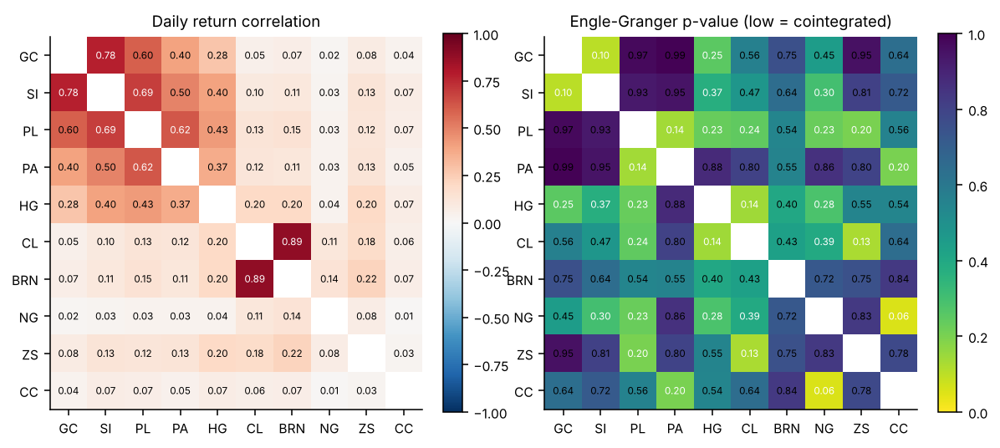
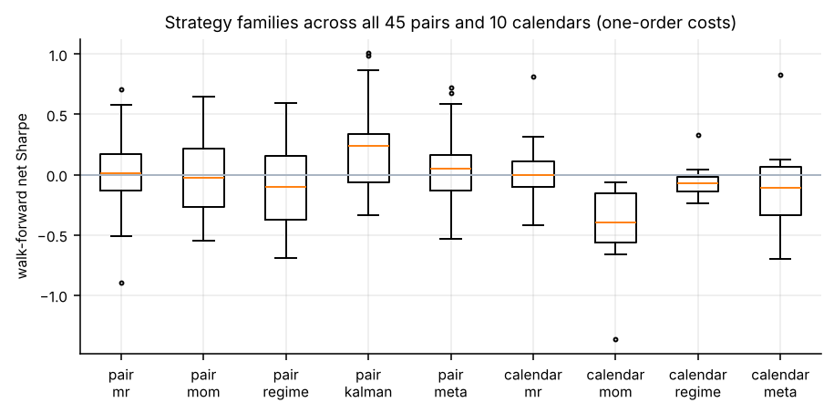
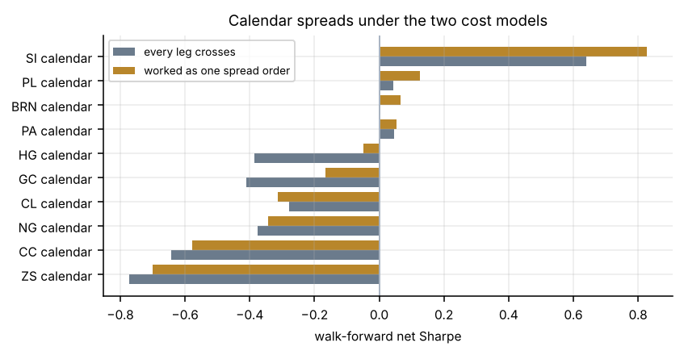
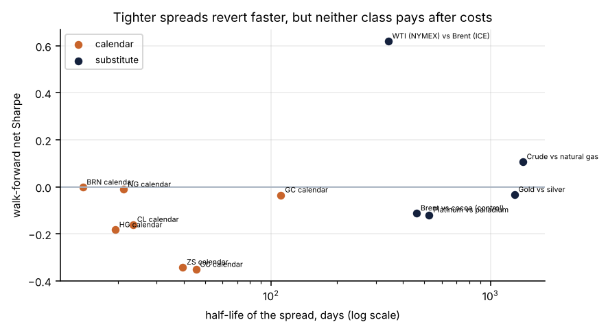
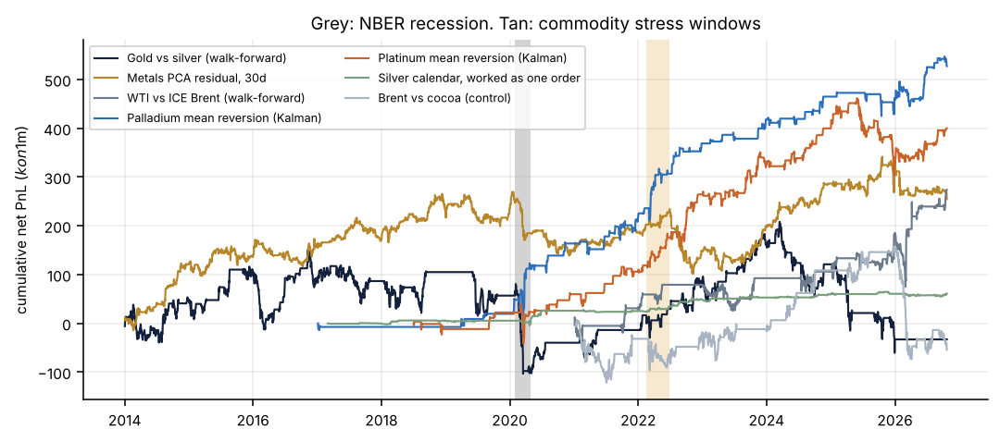

# Relative value in commodity futures: what survives costs on daily data

FINM 37000, Group 13. Cross-commodity study built on the GC/SI pairs pipeline in this repo.

Every number below comes from `research/universe/study.py` run on the Databento data we already hold (nothing new was downloaded for this study). The tables behind the text are in `docs/study/`, and `docs/study/summary.json` holds every headline figure quoted here.

## Summary

- The project's main strategy, gold against silver mean reversion, does not work after costs. Gold and silver are not cointegrated over 2010 to 2026 (Engle-Granger p = 0.87), the walk-forward Sharpe is -0.85, and the ledger shows the trade itself loses money; costs add only about $23k to a gross loss of about $807k on $1m. The gold/silver ratio trends for years instead of reverting.
- Looking wider does not rescue the idea. Across 10 tradable products on CME and ICE (metals, crude, Brent, natural gas, soybeans, cocoa), none of the 45 pairs is cointegrated over 2014 to 2026, and no pair stays cointegrated in more than 32% of rolling two-year windows, even when daily correlation is high (crude and Brent 0.89, gold and silver 0.78).
- Tightly anchored spreads do revert faster. Calendar spreads have a median half-life of about 23 days against more than 500 days for cross-commodity substitutes. But on daily data, after paying the spread, neither class earns a reliable return.
- Charging cost per spread instead of per leg (the spread worked as one order, one leg crossing) adds 0.1 to 0.35 of Sharpe to calendars. It helps, but it does not turn losers into winners. Only the silver calendar is clearly positive (Sharpe 0.83, under 1% a year at this size).
- The strongest numbers came from results our own controls exposed. The best "pairs" (palladium against soybeans, Brent or cocoa, Sharpe up to 1.0) have hedge ratios near 0.1 to 0.3, and the same rule on palladium alone scores the same, so the edge is outright mean reversion in palladium and platinum, not a spread. WTI against ICE Brent (Sharpe 0.62 since 2021) weakens to 0.13 on settlement prices, rests on six years, and is outside this course's permitted scope.
- Regime matters more than parameters. Gold/silver loses about 16% of capital in the three months of the 2020 recession, the multi-metal residual trade only works in calm markets, while palladium mean reversion and the silver calendar do better in stress than in calm.
- After correcting for 1,750 configurations and 576 walk-forward series (deflated Sharpe), nothing clears a 50% probability of a true positive Sharpe. The honest conclusion is that there is no reliable daily relative-value edge in this universe, and that the leads worth pursuing are execution-level (spread order handling, intraday) and the palladium/platinum mean reversion.

## 1. Question and scope

The course project asks for a daily pairs strategy on CME futures. We built it for gold and silver (Part A) and, when it failed, used the same machinery to ask a broader question: in commodity futures, is spread mean reversion only as strong as the economic force tying the spread together, and does any of it survive realistic costs on daily data?

We sort spreads by how tightly they are anchored:

| Class | Example | Anchor |
| --- | --- | --- |
| Calendar | crude front month against second month | storage and carry arbitrage |
| Substitute | gold against silver, WTI against Brent, crude against gas | related demand, shipping, substitution |
| Venue and processing | NG physical against Henry Hub financial, crack and crush spreads | same underlying, or a plant margin |

The venue and processing classes (NG vs HH, the 3-2-1 crack, soybean crush, sugar white premium) are coded in `research/universe/run_universe.py` but could not be tested: the products they need (RB, HO, ZM, ZL, SB, white sugar) were not downloaded, and Henry Hub financial (HH) trades too rarely to use without its settlement file. They stay as future work.

Scope note: the README excludes a Brent/WTI mean-reverting strategy from this course. The WTI/Brent results here are reported as research findings, not as the project's strategy.

## 2. Data



| Product | Exchange | History used | Price | Rolls a year |
| --- | --- | --- | --- | --- |
| Gold GC, silver SI, platinum PL, palladium PA, copper HG | CME | 2010-06 to 2026-10 | settlement | 4 to 5 |
| Natural gas NG | CME | 2010-06 to 2026-10 | settlement | 11.7 |
| WTI crude CL, soybeans ZS | CME | 2010-06 to 2026-10 | last trade | 11.6 and 5.0 |
| ICE Brent BRN, NY cocoa CC | ICE Europe, ICE US | 2018-12 to 2026-10 | last trade | 11.8 and 5.4 |
| British pound 6B | CME | 2010-06 to 2026-10 | last trade | FX conversion only |

Full table: `docs/study/data_inventory.csv`.

- Daily bars (`ohlcv-1d`) for every contract under each parent symbol, and settlement prices and open interest from the `statistics` schema where we have them.
- Settlement prices are used when they cover at least 95% of a product's history; otherwise last-trade closes are used for the whole history, so a product never mixes the two price definitions. Section 8 reruns everything with settlements wherever available.
- Continuous series roll on liquidity: open interest when it covers the history, otherwise a smoothed volume rule, and only to one of the next three listed contracts, so a one-day volume spike in a far month cannot hijack the roll. ICE products without open interest roll on a calendar schedule. Contract months are parsed from the symbol and keyed on the instrument id (symbols repeat every decade, so GCZ6 is both December 2016 and December 2026).
- Weekend bars are dropped. Prices are converted to USD with the CME FX future where needed.

## 3. Method

The pipeline is the same for every strategy:

1. Continuous contracts with correct rolls; PnL is always computed on the contract actually held, so roll gaps never create fake returns.
2. A signal decided at the close of day t, filled at the close of t+1.
3. Sizing to a 10% annual volatility target on $1m, capped at $4m gross notional, in whole contracts.
4. Costs on every fill and every roll. Two cost models:
   - per leg: every leg crosses half a tick and pays exchange fees and commission;
   - one order (spread): every leg still pays fees, but only one leg crosses half a tick, as when a spread is worked as a single order or legged passively on the hard side.
5. Parameters chosen out of sample: a fixed grid (z-score window 20, 60, 120 days by entry 1.5, 2.0, 2.5) and, each year, the configuration with the best trailing three-year net Sharpe (walk-forward). Only walk-forward results are quoted as performance.
6. Multiple testing: the deflated Sharpe ratio (Bailey and Lopez de Prado, 2014) against every configuration we tried.
7. Controls: a pair with no economic link (Brent against cocoa) and each product traded alone with the same rule.

Strategy families: z-score mean reversion; trend on the spread (sign of the spread against its moving average, weekly rebalance); a regime switch (rolling Hurst exponent: mean reversion when H < 0.45, trend when H > 0.55, flat otherwise); a Kalman-filter hedge ratio trading the standardized forecast error; yearly formation and trading screens (Gatev, Goetzmann and Rouwenhorst style) for pairs and Johansen triples; and PCA residual s-scores (Avellaneda and Lee, 2010).

## 4. Statistical properties

| Product | ADF p, log price | KPSS p, log price | Hurst, log price | Annual vol | Excess kurtosis |
| --- | --- | --- | --- | --- | --- |
| GC | 0.97 | 0.01 | 0.47 | 16.5% | 8.8 |
| SI | 0.75 | 0.01 | 0.46 | 33.3% | 35.7 |
| PL | 0.10 | 0.01 | 0.46 | 30.1% | 9.7 |
| PA | 0.58 | 0.01 | 0.43 | 38.6% | 9.9 |
| HG | 0.67 | 0.01 | 0.47 | 23.7% | 26.6 |
| CL | 0.61 | 0.01 | 0.53 | 42.0% | 18.6 |
| NG | 0.74 | 0.01 | 0.47 | 57.5% | 4.6 |
| ZS | 0.55 | 0.01 | 0.49 | 19.2% | 3.0 |
| CC | 0.84 | 0.01 | 0.52 | 40.3% | 6.6 |
| BRN | 0.88 | 0.01 | 0.50 | 40.4% | 17.2 |

Every log price is non-stationary (ADF cannot reject a unit root, KPSS rejects stationarity), every return series is stationary, and returns are heavy-tailed (silver and copper most). Daily autocorrelation is close to zero everywhere, so there is no simple one-day reversal to harvest. The KPSS p-values hit the bottom of the lookup table, so the true values are smaller than 0.01.

Correlation is not cointegration. The heatmap above shows strong daily correlation inside the metals and between crude and Brent, yet 0 of 45 pairs pass an Engle-Granger test at 5% over 2014 to 2026, and the most stable pair is cointegrated in only 32% of rolling two-year windows (`docs/study/relationships.csv`). That is the core reason static pairs trading struggles here.

## 5. Results by commodity group

### 5.1 Metals

- Gold against silver, the project strategy (`src/gcsi`, beta-neutral with micros): walk-forward Sharpe -0.85, gross loss about $807k and costs about $23k on $1m over 2015 to 2026, 43 trades. Gold and silver were cointegrated in only 2 of 17 calendar years. In the cross-commodity engine (volatility-targeted, rolling beta) the same pair is flat (walk-forward Sharpe -0.03, worst drawdown -22%).
- Platinum against palladium: walk-forward Sharpe -0.12.
- Metals PCA residual (each metal against the first principal component, 30-day OU s-score): Sharpe 0.35, 2.0% a year, worst drawdown -13%. The earlier metals lab, an independent implementation with different rolls, scored 0.54 for the same idea, so the estimate is sensitive to engine details.
- Yearly formation screens: the best Johansen triple each year scores 0.24; the best pairs score -0.12.
- Calendars: silver is the only clearly positive one (0.83 with one-order costs); gold, copper, platinum and palladium are between -0.17 and 0.13 once costed as one order.
- Palladium and platinum traded alone with the Kalman rule: Sharpe 1.02 and 0.76 since 2017 (5.4% and 4.1% a year, worst drawdowns -4.9% and -10.8%). See section 5.4 for why this matters.

### 5.2 Energy

- WTI (NYMEX) against Brent (ICE): walk-forward Sharpe 0.62 since 2021, 4.6% a year, worst drawdown -9.3%, positive in every year from 2021 to 2026. It is the best structure in the substitute class and the only one that stays near 50% after the deflated-Sharpe correction (49.5% across all 209 structure configurations, 67.8% within its family). But it falls to 0.13 with settlement prices on the overlapping years, it starts in 2021 because ICE history begins in December 2018, and it is outside the course scope.
- Crude against natural gas: 0.11, worst drawdown -25%.
- Calendars: crude -0.16 (last trade) but 0.23 on settlements, natural gas about 0, Brent about 0. The crude result flipping sign with the price definition is the clearest example of how fragile calendar results are on daily data.
- Energy screens and PCA: the best yearly triple scores 0.21; PCA residual on energy is negative.
- Natural gas alone with the Kalman rule: 0.43.

### 5.3 Agriculture and softs

- Soybean calendar: -0.34 (last trade), -0.04 on settlements; -0.70 with one-order costs in the pairs engine.
- Cocoa calendar: -0.35, and cocoa traded alone loses (-0.48), consistent with its 2023 to 2025 price explosion.
- Brent against cocoa, the deliberate control with no economic link: -0.11, and it behaves like noise across regimes, as it should.
- The processing spreads that define this group (soybean crush, oil share, corn ethanol margin, sugar white premium) need products we did not download.

### 5.4 Cross-commodity screens and the control that changes the story

- Pairs chosen each year from all products: -0.26 (formation z-score) and 0.05 (rolling z-score). Triples: 0.24. Cross-commodity PCA residual: -0.28.
- Kalman-filter pairs look like the best family (median walk-forward Sharpe 0.24, positive on 64% of pairs, best pairs near 1.0). The control explains it: the top pairs carry hedge ratios of about 0.1 to 0.3, and the same rule on each product alone gives nearly the same Sharpe (palladium 1.02 alone against 1.01 paired with soybeans). The Kalman "pairs" are mostly outright mean reversion of one leg around a slowly adapting level. We report it as a lead in palladium and platinum, not as a spread result.

## 6. Strategy families and cost models



| Spreads | Family | Spreads tested | Median walk-forward Sharpe | Share positive |
| --- | --- | --- | --- | --- |
| Pairs | z-score mean reversion | 45 | 0.01 | 51% |
| Pairs | trend on the spread | 45 | -0.03 | 40% |
| Pairs | Hurst regime switch | 45 | -0.10 | 44% |
| Pairs | Kalman hedge | 43 | 0.24 | 64% |
| Pairs | best of all, chosen yearly | 45 | 0.05 | 56% |
| Calendars | z-score mean reversion | 10 | 0.00 | 50% |
| Calendars | trend on the spread | 10 | -0.40 | 0% |
| Calendars | best of all, chosen yearly | 10 | -0.11 | 40% |

One-order cost model shown; `docs/study/families.csv` has both.



| Calendar | Per leg | Worked as one order | Change |
| --- | --- | --- | --- |
| Silver | 0.64 | 0.83 | +0.19 |
| Platinum | 0.04 | 0.13 | +0.08 |
| Brent | 0.00 | 0.07 | +0.06 |
| Palladium | 0.04 | 0.05 | +0.01 |
| Copper | -0.38 | -0.05 | +0.34 |
| Gold | -0.41 | -0.17 | +0.24 |
| Crude | -0.28 | -0.31 | -0.04 |
| Natural gas | -0.38 | -0.34 | +0.03 |
| Cocoa | -0.64 | -0.58 | +0.06 |
| Soybeans | -0.77 | -0.70 | +0.07 |

Working the spread as one order halves the crossing cost and lifts most calendars, most of all where the spread is a few ticks wide (copper, gold, silver). For cross-commodity pairs the cost model barely matters, because those positions turn over slowly. The yearly choice between configurations can still differ between the two cost models, which is why crude moves slightly the wrong way.

Books that hold every spread with its yearly-chosen strategy, risk-parity weighted, are flat to negative: 0.03 (per-leg costs) and -0.13 (one order), and calendars alone -0.22. No hand-picking, so this is the fairest single number for "does the whole idea work". It does not.



## 7. Regime study

Every day from 2014 is labelled calm, high volatility, the 2022 energy and metals shock, or the NBER recession of 2020. High volatility uses only past data (the trailing 63-day volatility of an equal-weight commodity basket above the expanding 80th percentile of its own history), so it could be used live. The recession label cannot: NBER announces recession dates months after the fact, so it is used only to describe what happened. Recession shading follows Harry Posner's `recession_bars.py` (MIT licence).



| Strategy | Calm (2,147 days) | High vol (1,018) | 2022 shock (97) | 2020 recession (63) |
| --- | --- | --- | --- | --- |
| Gold vs silver | 0.11 | 0.15 | 0.45 | -4.18 |
| Metals PCA residual | 1.08 | -0.62 | 1.68 | -2.85 |
| Palladium mean reversion | 0.79 | 1.21 | 1.85 | 1.80 |
| Platinum mean reversion | 0.98 | 0.64 | 2.79 | 0.03 |
| Silver calendar, one order | 0.90 | 0.92 | 2.86 | 0.48 |
| WTI vs ICE Brent | 0.52 | 0.69 | 1.21 | no data |
| Brent vs cocoa (control) | 0.40 | -0.40 | -0.86 | no data |

Sharpe by regime. The 2022 and recession windows are short, so read the sign, not the size.

- Gold/silver behaves like a short-volatility trade: flat in normal markets, then about -16% of capital in the three recession months.
- The metals PCA residual earns all of its return in calm markets and loses in high volatility and the recession.
- Palladium mean reversion and the silver calendar do better in stress than in calm, which supports keeping them as leads.
- Correlations break in a crash: crude and Brent move from 0.96 correlation in calm markets to 0.75 in the 2020 recession (the month WTI settled below zero), while gold and silver stay near 0.78 in every regime. The gold/silver problem is not correlation; the ratio itself trends.

The commodity stress windows of 2011 and 2013 sit before the 2014 scoring start and are shaded only on the charts.

## 8. Multiple testing and robustness

- Structures (`run_universe.py`): 209 configurations; the luck benchmark (expected best Sharpe from chance) is 0.62.
- Pairs and calendars (`lab3.py`): 1,750 configurations and 576 walk-forward series; luck benchmark 1.07 for configurations, 1.11 for walk-forward series. No walk-forward result reaches a 50% deflated probability; the best is 38% (palladium alone, Kalman), and the best true pair is 37.5% (palladium against Brent).
- Price definition: rerunning with settlement prices wherever we have them changes several calendar results by 0.2 to 0.5 of Sharpe and moves WTI/Brent from 0.62 to 0.13 (`docs/study/structures.csv`). For spreads a few ticks wide, the time of the price snapshot decides the answer.
- Engine: the same PCA residual idea scores 0.35 in this engine and 0.54 in the earlier metals lab, a reminder that roll and sizing details move results by more than most parameter choices.

## 9. What this means

1. On daily data, mean reversion in commodity spreads is weak where the economics is loose (substitutes drift for years) and too small to pay for crossing the spread where the economics is tight (calendars revert in weeks, but by a few ticks).
2. The cost of execution is part of the strategy. Working spreads as one order is worth 0.1 to 0.35 of Sharpe on calendars, which is a larger effect than any parameter choice we tried.
3. Most attractive backtests in a search this wide are artefacts. The controls (single-product runs, a no-link pair, a second price definition, a second engine) caught every one of our best-looking results.
4. Two leads are worth a proper, pre-registered follow-up: medium-term mean reversion in palladium and platinum, and the silver calendar traded as a listed spread.

## 10. Limitations

- Daily data only; no intraday prices or order book, so execution is modelled, not measured.
- ICE history starts in December 2018, so Brent and cocoa results cover 2021 to 2026 out of sample.
- Settlement prices are missing for crude after 2022, soybeans after 2020 and all ICE products, so those use last-trade closes.
- Several planned products (RBOB, heating oil, soybean meal and oil, sugar, London cocoa, TTF) were not downloaded, so the processing class is untested.
- Costs use exchange fees and half a tick; real fills in thin deferred months and during stress can be worse.
- One recession in the sample: regime results are descriptive.

## 11. Next steps

- Intraday spread execution (Part B): measure the cost of working spreads as one order against legging, on CME top-of-book data for gold, silver and crude calendars.
- A pre-registered test of palladium and platinum mean reversion on a held-out period, with the rule fixed before looking.
- Settlement data for every leg, and the processing spreads (cracks, crush, white premium) once the data can be pulled within a fixed budget.
- Cross-exchange spreads (NYMEX against ICE) with synchronized prices from both venues.

## 12. Reproduce

From the repo root, with the Databento cache in `data/databento` (no downloads happen):

```
set PYTHONPATH=src
python research\universe\study.py --cache data\databento --runs output\study --docs docs\study
```

This runs the structure lab twice (last trade and settlement), the pairs lab, the statistical tests and the regime study, and writes every table and figure in `docs/study/`. About 5 minutes on a laptop.

## Appendix A: files

| File | Content |
| --- | --- |
| `docs/study/data_inventory.csv` | products, exchanges, history, price source, roll behaviour |
| `docs/study/stat_tests.csv` | ADF, KPSS, Hurst, volatility and tail statistics per product |
| `docs/study/relationships.csv` | correlation, Engle-Granger p-value, cointegration stability and half-life for every pair |
| `docs/study/structures.csv` | every structure: half-life, Hurst, ADF and walk-forward Sharpe on both price definitions |
| `docs/study/structures_walkforward.csv` | walk-forward structures, screens, PCA and books with deflated Sharpe |
| `docs/study/pairs_walkforward.csv` | all 576 walk-forward series from the pairs lab |
| `docs/study/families.csv` | strategy family by cost model |
| `docs/study/cost_models_calendars.csv` | calendar spreads under the two cost models |
| `docs/study/regimes.csv`, `regime_correlations.csv` | the regime study |
| `docs/study/summary.json` | every number quoted in this report |

## Appendix B: a note on data costs

While pulling the extension data, parallel download scripts ran with their cost guard switched off and went past the course credits before they were stopped. The pull script (`pull_universe.py` in the course folder) now refuses to download unless a budget file exists, the estimate printed in the same run is within budget, the user types the exact dollar figure, and no other pull is running; it logs every request and stops at 80% of the budget. Any extension of this study should start from the smallest possible pull and a confirmed cost.
